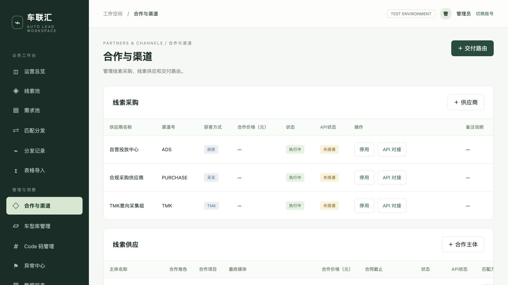

# API状态本地验收

2026-11-23，仅修改本地程序。311项全量隔离回归通过（64.511秒），最终6项专项通过（1.889秒）；JS语法和git diff --check通过。浏览器只访问8891临时库，已验证线索采购与线索供应均出现API状态，无有效联调证据的模拟记录均显示未接通。

覆盖：生成密钥不能冒充成功、手动导入与模拟发送不算、签名成功按渠道关联、新密钥需重新验证、历史签名审计兼容、直连成功不传播给乙方或KA、乙方成功不传播给最终媒体直连、失败及未知不算、鉴权回调可确认、配置快照变更失效、不可归属探针不猜测、业务停用不抹去联调证据、组织隔离、结果不含密钥。

未请求任何实际合作方接口或发送客户线索。没有线上变更、没有迁移或业务数据改写。此次并未声称历史独立探针已自动绑定到新合作主体。

