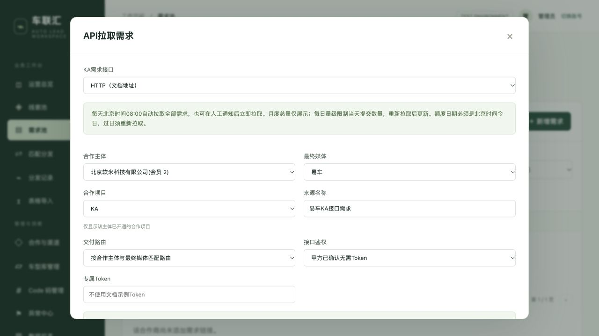
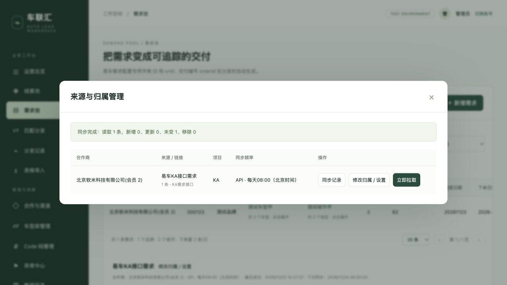

# KA需求API本地验收记录

日期：2026-11-23，北京时间。仅本地代码与临时数据库，未修改线上、本地业务库，未调用甲方真实接口，未发送真实线索。

## 规则与结果

用户确认无需Token、全量返回、status只有0、月度量只展示、每日量限制当天提交，归属北京软米科技有限公司(会员 2)→易车→KA。人工通知后可立即拉取，另每天北京时间08:00自动拉取。不存在对应主体时页面要求从真实合作配置选择，不自动新增或猜测近似主体。

297项全量Python用例通过（60.546秒），其中KA相关21项；JS语法、既有合作项目DOM用例及git diff --check通过。全量测试期间发现清空脚本的表白名单未包含新增配置表，已修复并重新回归；没有执行任何实际业务清理。

## 测试项

- 成功/失败响应、错误状态、坏行、重复编号、无效时间、零数量和凭证安全。
- 多品牌/厂商/车型配对、多城市命中、独立品牌筛选、品牌统计去重。
- 同编号重复拉取不新增、额度更新保持需求ID、历史版本保留、全量消失与空结果移除、失败整体回滚。
- 已发送失败或无效仍占当天提交数、月度量为0不限制发送、未发送预占、额度下调取消排队及上调恢复。
- 昨日额度拦截、零额度拦截，跨日北京时间8点定位、手动不推迟固定时刻、到期只拉一次及重新调度。
- 主体项目校验、组织隔离、权限、加密Token不回显、固定地址无重定向、禁止KA使用既有会员提交协议。
- 028→029迁移及重启不重复执行，旧需求内容不变，外键完整。
- 真实浏览器：选择API来源、默认主体/易车/KA、默认无需Token、首次模拟拉取、多城市车型折叠、下一次为翌日08:00、人工再次拉取新增0/更新0/未变1。

## 页面证据

## 上线范围与限制

未部署或重启线上服务。主业务本地8765也未重启，避免无备份迁移业务库；验收仅使用独立8889临时服务，验收后关闭。新增迁移029依赖本地此前未发布028。真实HTTP接口可达性及真实字段返回尚未联调，本次不声称对方接口已验证可用。KA线索提交接口另行对接，不将本次拉取需求扩展为会员接口推送。

## 本地文件SHA-256

- ka_demand_api.py: ce813875c2c4989527277c1ba66bc62165f0b2762cd6b9f3f5a1344c77ac8ede
- ka_demand_sources.py: e9ed2b7f671580d95032b7970121f0397cc105e2a5d7949d44a64d7d7a3c10cc
- migrations/029_ka_demand_api.sql: 9210df22b497a3f494ebd89f573cd6ff27f5012879b28be07c0a0f541f1c8561
- domain.py: f3aefd85a0026915e043b30ede8123437299e47c6b5c8ed7cc5a52c1b99cc2e2
- distribution.py: 634b61df950b57491bf29fc1f3b99a61c96b320d26360f26cf793ada5f0d74fa
- synced_demands.py: 884534ca78790fbf0b848440b0842a79319842792d65037f9213baeb928934b7
- demand_sync.py: 110f603c2cdd14d06eca1c5de0bf79c293a27418624ea0f6281350adc41888de
- server.py: d3c033ae2a7bf677f486b991513df51b8ddb639ed73541b5f718aa4ab7a0fa3b
- static/app.js: ff0393436c5f205add05c624b78fd4596d898e2579f4fe29c6dfa8888a57326c
- scripts/reset_business_data.py: 0a6c68a98f846a21779896e2589a4c2985857ce2840f2aaef3bfe1c8e9b77114
- tests/test_ka_demand_api.py: 2d2c289f59cdd799163adfcfa747d4daadd26ab7b848db966aa9de5501a28937
- tests/test_ka_demand_sources.py: 97213bc6b9bb009a78cba3c9e13d075fb6e8cfd009b84aa84a9d25539b55d665
