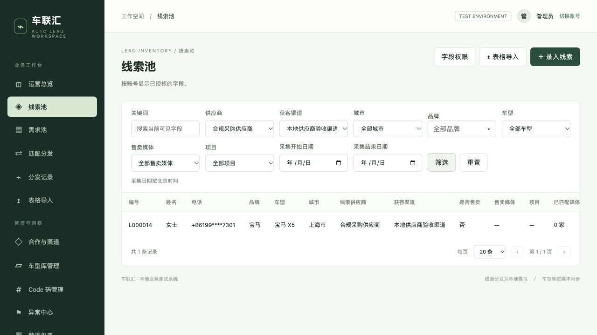
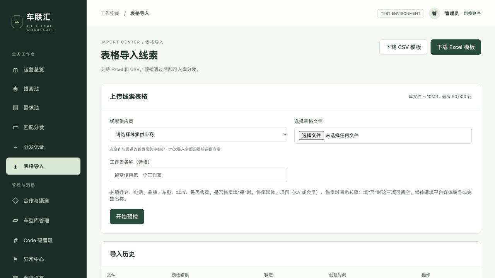

# 线索供应商录入与筛选本地验收

日期：2026-11-23。306项全量隔离回归通过（61.987秒），JS语法与git diff --check通过。未连接线上，未迁移或修改真实业务数据库。

已验证：手动及表格供应商必填，错误角色、缺失、跨组织、停用供应商拒绝；预检后停用供应商会阻止入库；绑定所选供应商并保留获客渠道；两个筛选可以组合；隐藏字段无选项、详情或筛选推断；现有测试数据显式选择供应商后，匹配与分发规则回归通过。

浏览器使用8890临时数据库：手动新增虚构“女士”线索并选择合规采购供应商，获客渠道填写本地供应商验收渠道；保存后显示正确归属及称谓，两项组合筛选仅返回1条。表格导入页面提供供应商必选，CSV/XLSX预检及入库由隔离用例验证。未在真实环境上传文件或创建线索。

运行原本地业务服务及线上服务均未重启。此处截图只用于临时验收，测试数据随服务关闭清理。
