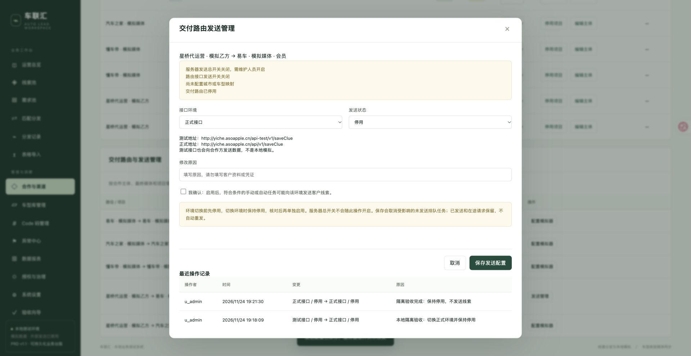

# 交付路由发送管理本地验收

日期：2026-11-24。分支：codex/route-send-controls-20261124。仅临时数据库，不请求合作方接口，不修改线上或原本地服务。

新增7项测试覆盖：服务器开关不可被页面开启及单路由隔离；环境切换须停用并单独启用、审计；权限/组织/并发版本/非法输入；排队取消/预占释放/预览失效；正式固定地址模拟传输/环境快照/旧回调保留/接通证据按环境隔离；迁移重复启动；协议禁用及地址环境不一致。

全量339项通过（70.150秒），其中既有软米17项通过。前端最终JS语法及git diff --check通过。Chrome临时页面验证配置保存、操作留痕、服务器阻拦、勾选确认拦截及后端拒绝环境切换同时启用；错误显示在弹窗内，最终临时路由保持停用。截图是虚构测试主体，不代表线上配置。

当前只支持已绑定的软米会员路由，KA发送接口未实现，不能直接转为会员协议。服务器总开关需维护人员单独管理；页面显示的开关允许不等于所有业务规则均满足。正式地址仅完成本地模拟验证，未获实网接收结果。部署需先核对线上版本、备份并执行031迁移，本次没有部署。
