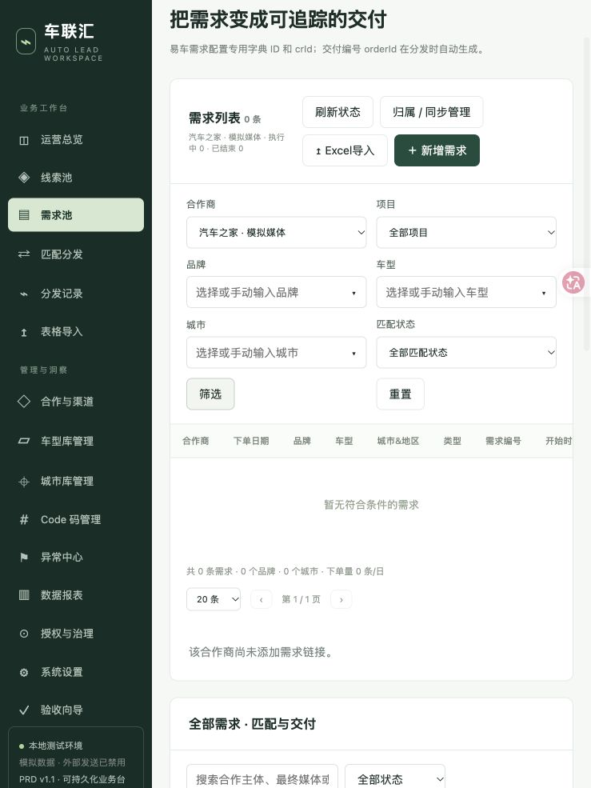
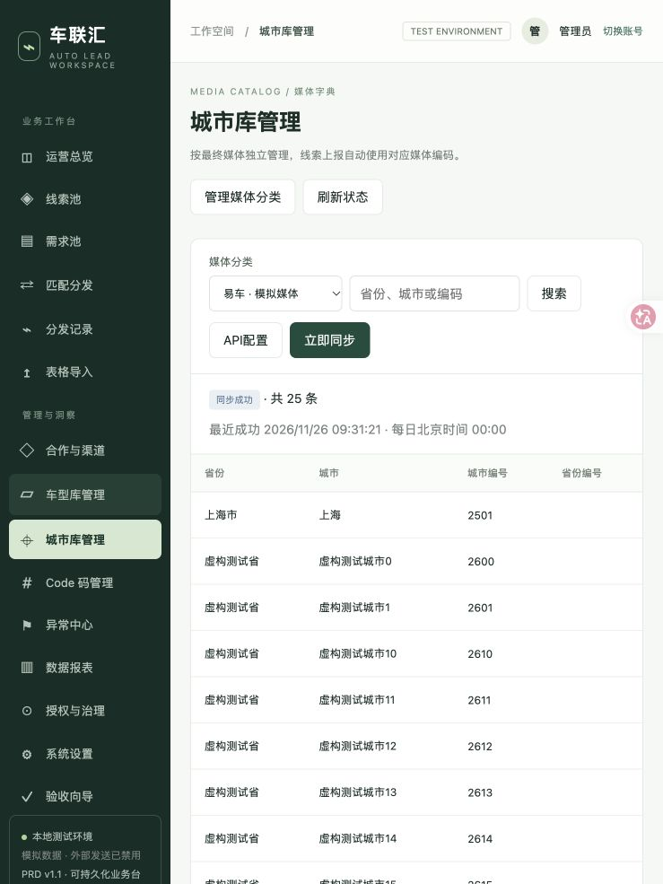

# 空状态与字典搜索栏排版修复复验

日期：2026-11-26。分支：codex/layout-acceptance-fixes-20261126。仅前端展示调整，无后端规则、接口或数据库迁移。

## 修改

1. 共用table函数将空状态放在横向滚动容器外，使用role=status。宽表头仍可滚动，有数据的行保持原渲染；空提示按可见宽度换行，避免在超宽单元格中居中后裁切。
2. 仅对catalog-search-form底部对齐，并将媒体选择、搜索输入和搜索按钮统一40px，不扩大到其他筛选表单或配置弹窗。

## 验证

- Chrome：739×985和1280×984复验通过，共保存9张当前复验截图。739下空提示文本边界约405～524px，完全位于503px宽容器内，页面宽739px未整页横向溢出。
- 739下城市、车型选择框/搜索框/搜索按钮均40px高，底边相同；1280下同为40px。
- 字典搜索无结果、需求过滤无结果的提示均完整显示；恢复需求筛选后仍正常显示3条测试需求，结束需求当前量级仍为0。
- API配置弹窗及本机地址校验错误在当前弹窗内完整可见，不被本次CSS影响。
- JS语法检查、既有媒体字典UI交互检查、来源删除UI交互检查及git diff --check通过。本次无后端变更，未重复全量Python回归，不借用旧报告测试数。

## 隔离与范围

主工作区包含其他尚未提交的功能，未将其打入本分支。本次在该功能快照叠加相同两文件补丁的临时库中验收；提交只包含独立排版补丁及本记录。字典前端入口由对应功能提供，本分支CSS使用固定表单ID，未引入字典业务功能或迁移。合并后的最终候选版本仍应按发布流程核对。

未修改原业务库，未开启发送或对外请求，未重启原业务服务、合并main或部署线上。测试服务仅本地8897、临时库及假API且阻断外网；窗口尺寸已恢复。

