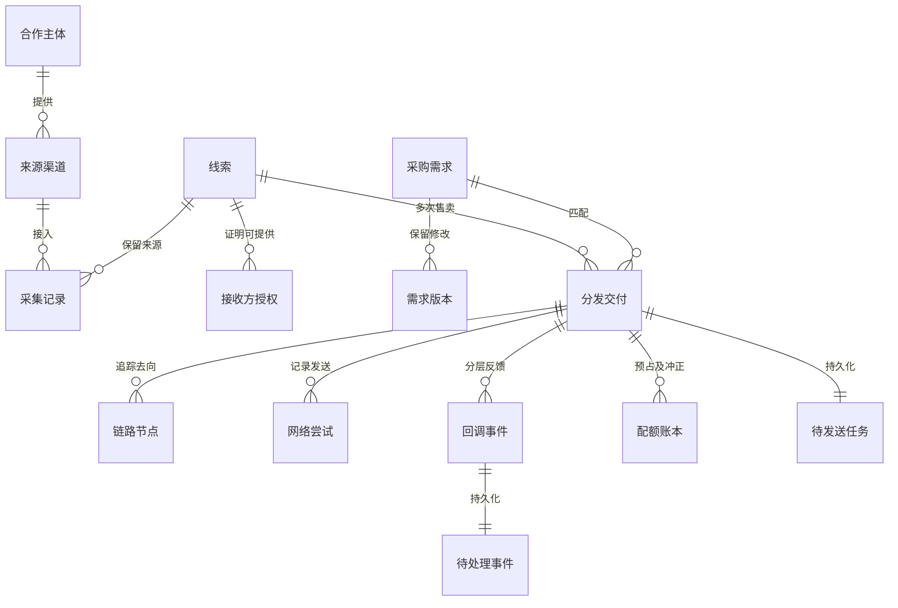

# 用业务台账理解数据库

本地测试系统使用SQLite关系数据库，启用外键、WAL和BEGIN IMMEDIATE事务。正式生产的PostgreSQL迁移与压测尚未完成。

## 五个判断标准

1. 一个手机号同一车系重复从多个渠道采集，产生多条采集记录，但不重复新增同一意向线索。第一次来源不被覆盖。
2. 一条线索给两个媒体，产生两个分发交付。两个媒体的入库和有效结果不会互相覆盖。
3. 一笔分发有多次发送尝试，也只有一笔业务交付，不重复增加收入和获客成本。
4. 乙方和最终媒体分别有节点。乙方接收不替代媒体入库结果。
5. 每次配额变更都写账本。需求显示的在途和有效数，必须同时与交付状态、账本求和一致。

## 对应实际表

|业务台账|实际表|防错规则|
|---|---|---|
|来源与主体|partners、channels|合同有效、角色校验、组织隔离|
|线索与采集|leads、ingestions|渠道+来源编号唯一；手机号HMAC与车系窗口去重|
|授权|consents|每线索每接收主体独立核验，记录撤回|
|需求|demands、demand_versions|媒体编号由媒体提供，按组织+媒体+编号唯一；内部id另行生成|
|交付与节点|deliveries、hops、attempts|每笔交付独立，保存需求、价格、路由及载荷快照|
|去重与配额|dedup_registry、daily_counter、quota_ledger|同媒体跨路径去重；事务预占；只追加变动账本|
|任务与回调|outbox、callback_events、inbox|先持久化再应答；重复事件幂等；不同维度各自版本控制|
|权限与审计|users、sessions、audit_log、exports|角色校验、会话/CSRF、禁止自审、审计不允许业务更新删除|
|隐私治理|privacy_requests、privacy_notices|立即停发、取消排队、通知历史接收方|
|设置|settings|媒体数量可调，版本控制及修改审计|

精确字段、类型、索引及外键请看 migrations/001_initial.sql。业务组织字段由服务端会话决定，前端不能通过请求体任意切换组织。

## 加密与删除

电话和姓名、待导入原始记录及上报载荷在应用层加密。电话指纹使用租户标识与密钥HMAC。测试账号密码采用PBKDF2派生，数据库不保存口令明文。测试密钥存于本机权限受限文件；生产应改用KMS。

删除操作清理线索明文、历史发送载荷、导入暂存中的同手机号行及授权证据引用。备份恢复后，先应用数据库外的撤回删除清单，再开放HTTP服务。外部接收方通知仅为模拟任务。

## 一致性复核入口

在「验收向导」点击「检查当前数据库一致性」。检查每项需求的有效/在途计数、配额账本总和、交付配额状态、外键和同媒体重复分发。检查失败不能说明所有问题都被发现；检查通过也不代表生产容量和安全审计完成。

## 原表需求接入（迁移017）

原表项目通过demands.external_project_id与实际需求唯一关联。quantity_basis区分DAILY每日目标和TOTAL累计目标；每日配额按北京时间及deliveries.day计算，不重置历史账本。品牌、车型集合、地区集合、全系/全国标记独立保存，页面折叠不影响完整地区匹配。原表结束或移除关闭对应需求，保留原始字段与已发送快照。
