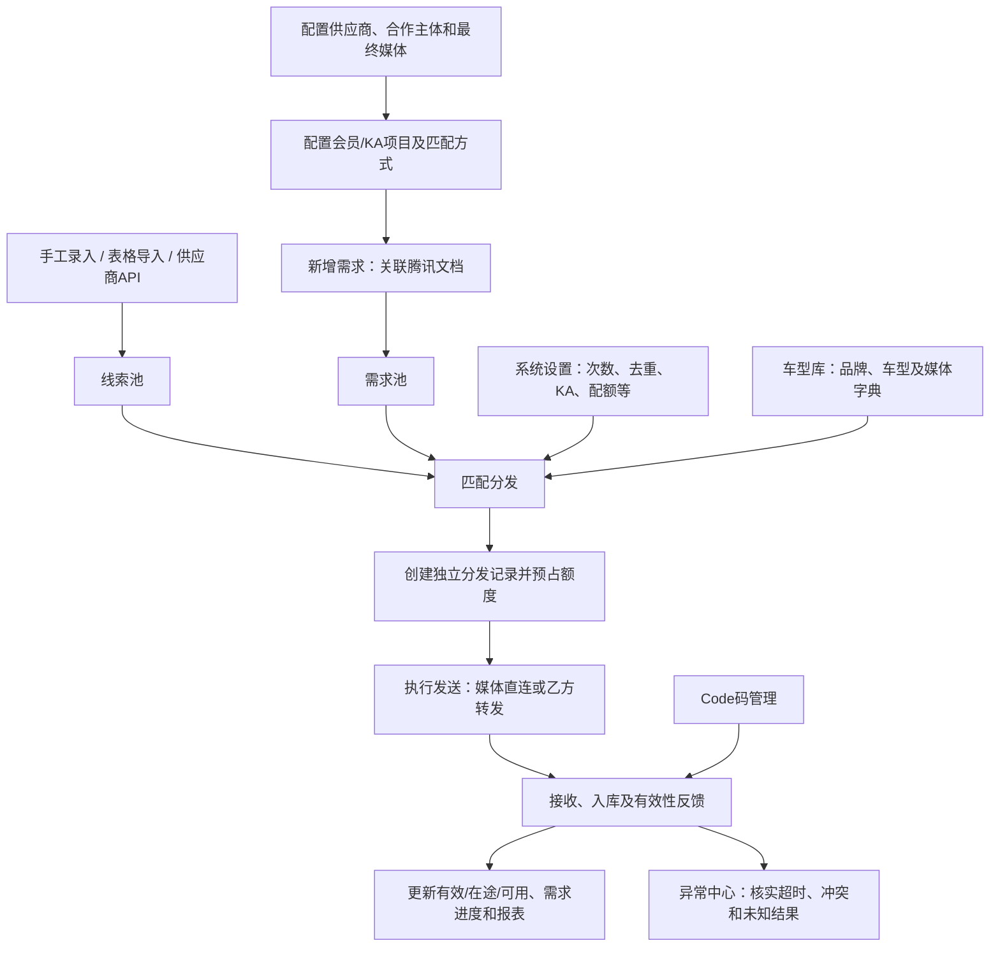

# 汽车销售线索平台：系统使用流程与功能关联

整理日期：2026-11-13（北京时间）  
依据：当前页面、服务端规则及本机配置。本文描述已实现功能，不等同于最初PRD中的所有规划功能。

## 一、先理解平台管理的五类对象

| 对象 | 业务含义 | 在哪里管理 |
|---|---|---|
| 供应商 | 谁提供线索 | 合作与渠道 → 线索采购 |
| 合作主体 | 谁采购、接收线索，可以是媒体或乙方 | 合作与渠道 → 线索供应 |
| 最终媒体 | 线索最终要进入哪家媒体 | 合作与渠道；新增乙方时必填 |
| 项目 | 同一主体下的会员、KA，分别管理匹配方式 | 线索供应、需求池汇总、匹配分发 |
| 需求 | 某项目具体需要的品牌、车型、地区、数量和时间 | 需求池 |

一个合作主体可以同时经营会员和KA；一个项目下面可以有多条需求。例如“易车会员”下面分别有宝马上海、宝马北京、奥迪上海等需求。线索和需求之间通过独立分发记录建立联系，同一线索多次售卖会产生多笔记录。

项目的匹配方式按“合作主体＋会员/KA”设置；需求池汇总还按最终媒体分组。因此，同一个乙方会员项目分送多家最终媒体时，各行数量分别展示，但匹配方式属于同一个主体项目，修改后共同生效。

## 二、系统主流程

当前发送及回调验证为本地模拟，不会因出现“上报成功”就代表已经进入真实易车库。车型库定时接口已准备，本次运行仍暂停真实车型同步。腾讯文档定时读取与线索向媒体发送是两个独立环节。

## 三、首次使用的配置顺序

### 1. 配置“合作与渠道”

**线索采购：**新增供应商，填写供应商名称、获客方式、合作价格和备注。获客方式可以输入新内容，保存后作为已有选项使用。需要供应商API接入时，在对应供应商的“API对接”中获取平台渠道号与凭证；接入方必须传正确的channel_id，系统同时核对凭证与渠道归属，不能只靠供应商名称识别。

**线索供应：**新增合作主体，选择媒体或乙方。媒体主体对应自己；乙方必须选择或输入最终媒体。输入“自有媒体”时按该乙方单独建立，如“老陈车服 · 自有媒体”；选择已有媒体复用原身份，输入新名称会保存新的媒体记录，并建立本地转发路由。

同一主体已开通的会员、KA分别列出。新增主体时只开通所选择的合作项目；另一项目必须在线索供应的“添加项目”中主动开通，默认手动匹配。合作价格和备注目前仍保存在主体层面，不是两套独立项目价格。

**交付路由与模拟器：**表示谁直接接收以及最终媒体是谁。例如直连是“平台 → 易车”，乙方转发是“平台 → 老陈车服 → 易车”。这里的本地路由和模拟接收设置不代表真实媒体接口已联调完成。

### 2. 检查“车型库管理”和“Code码管理”

车型库按媒体分别保存，提供品牌、车型、厂商等匹配和编码依据。已有易车车型库已经导入。运营手工输入的品牌或车型能够保存，不等于已经具备真实媒体上报所需的全部字典编码。

Code码管理目前以易车返回码为主，维护有效/无效及原因，相同原因的多个码可以用“/”展示；支持新增、修改、删除。回调识别和最终有效判断使用这些配置，不把“接口接收成功”直接当成有效线索。未知码或冲突结果需要核实，不能直接当无效释放额度。

### 3. 检查“系统设置”

本次核对时的规则：累计售卖上限2次、去重窗口30天、KA累计上限1次、禁止同一最终媒体重复售卖。参数可以调整，保留版本及审计。

累计售卖次数不会在去重窗口结束后清零。去重窗口用于识别同一手机号和品牌的其他线索记录，防止通过重复导入绕过限制。直连和乙方转发共享最终媒体限制。

全局分发开关优先于项目匹配方式；全局暂停时不会新增分发。自动总开关已开启不代表所有项目都自动执行，项目本身也必须为自动。

## 四、日常运营步骤

### 第一步：检查并同步需求

路径：需求池 → 新增需求。

“新增需求”打开原来的腾讯文档链接表单，流程是：输入链接 → 选择合作主体 → 选择最终媒体 → 选择会员或KA → 设置数量口径、同步频率和其他配置 → 保存并同步。

数量口径分两种：

- 每日需求量：每天需要的数量，例如每日5条。
- 项目时间内总需求量：整个项目期间共需要的数量，例如项目共100条。

默认跨合作商展示需求；可以组合筛选合作商、品牌、车型、城市、匹配状态。品牌、车型、城市支持输入关键词。多地区需求默认显示第一个，点击展开完整地区；匹配时检查全部地区。

上方是腾讯原表具体需求，下方是按“合作主体＋最终媒体＋项目”的交付汇总。系统预置的FLOW-TEST测试需求可以参与匹配和下方汇总，不会写回腾讯原表。已结束的原表需求保留展示，停止分发。

底部可看各来源最近成功时间、下次同步时间和错误。需要调整频率、立即同步或查看记录时使用“同步管理”。

### 第二步：录入线索

三种方式：

1. 少量线索：线索池 → 录入线索。
2. 批量线索：表格导入 → 下载Excel/CSV模板 → 上传 → 开始预检 → 查看错误/重复 → 确认入库。
3. 供应商API：按供应商对应的平台渠道号和凭证接入，平台保存来源信息及原始业务字段，并在详情中查看。

手工和表格的核心必填字段为姓名、11位有效手机号、品牌、车型、城市、是否售卖。手动录入与表格导入页面均须选择线索供应商，选项来自本组织“合作与渠道→线索采购”的有效供应商；文件内不要求逐行填写供应商，同批导入统一归属所选供应商。姓名原值只有“先生”或“女士”时，姓名栏直接展示该称谓；不因缺少姓氏显示为空。已有姓氏及称谓继续按原脱敏规则显示，姓名字段权限保持生效。品牌可以输入，车型可以选择全系或输入具体车型；获客渠道按实际来源填写。

是否售卖为“否”时，不填售卖媒体、项目和售卖时间；为“是”时，这三项必填，并计入历史售卖和去重判断。录入历史售卖不会主动再发送一次线索。

预检不是入库，必须完成确认入库才会形成可供后续处理的库存。重复行和错误行分别处理，不能把预检成功当成全部成功新增。

线索池负责查看、筛选、录入、字段权限及查看链路，已移除在此勾选线索并跳转匹配的入口。选择待分发线索统一在“匹配分发”完成。

### 第三步：选择手动或自动匹配

匹配方式在需求池汇总或线索供应中设置，作用于整个合作主体对应项目，不是只改一条需求。

**手动流程：**

进入匹配分发 → 默认查看全部可分发线索 → 选择“主体＋会员/KA” → 右侧按该项目需求和规则重新筛选 → 勾选或全选筛选结果 → 生成匹配预览 → 核对线索、采购主体、最终媒体、需求编号、项目 → 确认创建分发。

全选包含当前筛选结果的其他分页。切换主体项目会清空之前的线索选择和筛选，防止误发。预览只列可分发组合，同一线索对同一媒体有多项需求时不默认替运营决定，需选其中一项。

预览不预占额度，点击确认时重新检查版本、规则和剩余配额；其他操作占用了额度时，确认可能被拦截，需重新预览。手动确认后形成待发送任务，还没有完成发送。

**自动流程：**

将主体项目设置为自动 → 系统启用自动扫描 → 每30秒检查需求与线索 → 唯一候选或已人工指定目标时创建分发并执行本地模拟发送。

多个需求同时符合时仍等待指定目标，不按结算价格或星级擅自排序。新增或后续同步的需求继承项目方式。自动项目不能再通过手动创建按钮绕过模式；要手动测试，应先切回手动。

自动转手动后不再自动新建该项目分发；尚未发送的自动任务会取消并释放额度，已经发送的记录保留，不会自动恢复为“未售卖”。

### 第四步：执行发送并查看反馈

路径：分发记录。

手动创建后点击“执行待发送任务”，当前执行的是本地模拟发送。自动任务通常由扫描流程继续执行模拟发送。点击“完整链路”检查直接接收方、最终媒体、发送状态、入库结果、有效性、回调和额度变更记录。

接收成功、入库成功、有效线索是三个不同阶段。乙方接收成功也不代表最终媒体已经入库。

管理员/接入工程师可以在链路详情中进行模拟入库、模拟有效、模拟无效等操作，验证后续状态及额度变化。不要把模拟结果当成真实媒体反馈。

### 第五步：检查进度、异常与质量

- 需求池汇总：查看目标还差多少、在途多少、哪些项目没有执行中需求。
- 异常中心：查看未知结果、超时、未关联或冲突回调，核对后处理。
- 数据报表：查看来源与最终媒体的接收、入库、有效表现，以及多次售卖情况。
- 运营总览：查看全局库存、交付及待办，具体处理仍进入相应模块。

## 五、汇总数字的含义

| 字段 | 单位与含义 |
|---|---|
| 执行中需求 | 项；当前在执行的具体需求有几项 |
| 目标线索量 | 条；这些执行中需求需要多少条线索 |
| 有效 | 条；最终已确认有效，计入完成量 |
| 在途 | 条；已创建并预占额度、尚未结束配额占用的任务，包括待发送、接收后待判定、发送结果未知等 |
| 可用 | 条；需求还可接收的额度，不是线索库存数量 |
| 需求进度 | 总有效数量 ÷ 总目标数量，按数量加权，不平均各条需求的百分比 |
| 进展程度 | 目前仍以有效达成率计算星级，星级不参与自动排序 |

每项需求的可用量＝max（目标－有效－在途，0），然后逐项相加。每日需求使用归属于当天的交付数据，项目总量需求使用累计数据；混合时可点击“查看汇总”分别看口径。没有执行中需求时，数量为0、进度和星级显示横线。

确认有效：在途减1、有效加1，可用通常不变。判定无效或明确拒收：释放额度，可用增加。发送超时或结果未知：继续保留占用，不能因为没收到结果就直接释放。有效结果后续被更正时，系统按回调版本更新并调整台账。

需求额度释放，不等于线索售卖历史清零。已发送的无效线索仍保留发送与媒体去重历史；不能通过判定无效绕过同媒体重复售卖限制。

## 六、各模块的关联关系

| 模块 | 管什么 | 主要关联到哪里 |
|---|---|---|
| 合作与渠道 | 供应商、采购主体、最终媒体、项目及路由 | 决定来源身份、需求归属及分发去向 |
| 车型库管理 | 每家媒体的车型字典 | 支持品牌车型匹配、厂商归属及媒体编码 |
| Code码管理 | 易车结果码与有效/无效原因 | 影响回调结果解释、额度与报表 |
| 系统设置 | 售卖上限、去重、KA限制、全局开关 | 手动自动共用的规则 |
| 需求池 | 原表需求、同步配置和项目交付汇总 | 为匹配提供接收条件和可用额度 |
| 线索池 | 线索库存、历史售卖、获客渠道和详情 | 为匹配提供候选线索，保留来源及去向 |
| 表格导入 | 模板、预检、错误与确认入库 | 将批量数据写入线索池 |
| 匹配分发 | 主体项目选择、候选线索、预览及确认 | 连接线索与需求，形成独立分发记录 |
| 分发记录 | 发送任务及完整交付链路 | 接收回调，更新需求占用和有效数量 |
| 异常中心 | 未知、超时、冲突、未关联结果 | 关联交付记录并核实异常 |
| 数据报表 | 来源与媒体表现及售卖指标 | 统计线索、独立交付及反馈结果 |
| 运营总览 | 关键指标与待办 | 导航到线索、需求、分发和异常 |
| 授权与治理 | 授权核验、导出审批、撤回/删除及停止处理记录 | 约束访问和可分发范围，处理遗留待核验数据 |
| 验收向导 | 自动检查及数据一致性验证 | 辅助验证台账，不能证明真实媒体接口已接通 |

字段可见权限在线索池“字段权限”按账号设置；字段隐藏后，相应返回数据和筛选也受限制。管理员负责主体与规则配置，产品运营负责线索与分发，商务负责需求审核，合规专员负责授权和导出审批等。具体操作是否可见以当前账号权限为准。

## 七、常见情况的排查顺序

**选择线索为空：**先点全部主体并重置筛选 → 检查所选项目是否有执行中的需求 → 检查品牌、车型、完整地区、线索年龄 → 检查是否已发给最终媒体、累计售卖及KA上限 → 检查需求额度 → 检查主体、来源、路由和全局开关。线索池里有数据不等于这些线索当前能再次分发。

**切回手动后线索没回来：**先检查是否已经自动发送；切回手动不会删除历史发送记录，已发送线索可能因去重不再出现在候选池。

**需求池看着有需求但不能匹配：**上方包含保留展示的结束需求，且同步可能失败后保留旧快照。检查执行状态、起止时间、今日/总额度及最近成功时间。

**乙方有需求但路由不匹配：**检查需求的合作主体、最终媒体是否与乙方关联及路由一致，不要误改为媒体直连。

**表格预检失败：**确认Excel/CSV有效、使用当前模板；工作表名称留空读取默认工作表，查看错误行后再确认入库。

## 八、本次核对的当前状态及注意事项

1. 正式媒体发送关闭，易车未做真实联调；车型库自动拉取仍暂停。本地模拟会真实改变本机的售卖历史和配额，因此重复测试要使用新的虚构线索，而不是假定模拟不记账。
2. 当前腾讯文档来源设置为每30分钟同步、按每日需求量计算，但存在“文档数据地址与分享链接不一致”的同步错误。系统保留上次成功数据，不能将当前页面当成最新原表快照；日常开工应先检查并处理同步状态。
3. 本次核对时全部主体项目为手动，全局自动扫描开关开启。以后明确选择某项目自动，会开始处理该项目符合条件的线索。
4. 系统现有FLOW-TEST-001～006虚构需求和配套线索可做流程演练。先用手动完成一条：选择主体项目 → 选线索 → 预览核对需求编号 → 确认 → 执行待发送任务 → 模拟回调 → 核对有效/在途/可用变化。已测试使用的线索应按实际历史判断是否还能售卖。
5. 验收向导中个别示例仍沿用旧版入口文案，如“选择示例前5条”；日常操作按当前匹配分发页面的勾选/全选流程执行。

## 2026-11-23：线索供应商与获客渠道（仅本地）

供应商是提供这条线索的合作主体，获客渠道是录入或表格填写的信息流、搜索等渠道文字，两项分别维护。列表和详情新增线索供应商，筛选新增供应商及获客渠道并可与现有条件组合；先筛选后分页，未授权字段不返回、不提供选项且不参与过滤。旧线索仍显示原渠道关联的供应商，平台录入的旧数据不自动猜测供应商。重复线索追加来源记录，不静默更换原线索主归属。

POST /api/v1/leads须提供supplier_id；POST /api/v1/imports同样要求supplier_id，重新映射表头时保留选择。服务端按组织、SOURCE角色、启用状态、合同及渠道独立校验，拒绝缺失、跨组织、错误角色、停用或到期供应商。预检绑定渠道，确认入库时再次检查启停和合同，失败整体回滚。既有签名供应商API继续使用其密钥绑定渠道，不要求额外选择供应商。

复用供应商既有启用采购渠道；有多个来源渠道时优先PURCHASE后按ID稳定选取，均停用时不绕过停用新建渠道。没有任何渠道时才建立供应商专用录入渠道。不自动新增合作主体，不改历史数据，无数据库迁移。
